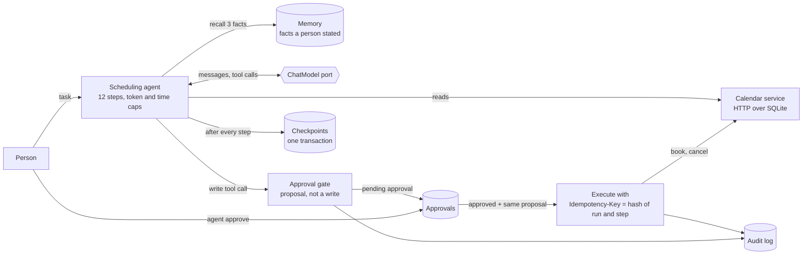

# Architecture: ai-scheduling-agent

A scheduling assistant that books, moves and cancels meetings on a calendar service. It reads freely; every write is a proposal that waits for a person. It runs inside step, token and time budgets, saves its state after every step so a crash resumes without booking twice, and remembers what people tell it about their calendars. This document names the parts, follows one booking through them, and says what a production version would add.

## Pattern

Ports and adapters (hexagonal), in four folders, with two systems in one repository: the **agent** and the **calendar service** it works against. The agent depends on the calendar through a port (`CalendarPort`) and talks to it over HTTP; the calendar service is its own small stack (domain rules, SQLite storage, a FastAPI interface) that shares the domain's slot arithmetic. The properties the lesson cares about (approval, idempotency, budgets, resumption, memory policy) are rules and are kept in `domain` and `application`, where they are tested without a database, a network or a model.

## Components

| Component | Layer | Owns |
| --- | --- | --- |
| `domain.calendar` | domain | working hours, the half-hour grid, overlap, `free_slots`, `validate_slot` |
| `domain.proposals` | domain | `Proposal` (book, move, cancel), its canonical form and digest, `write_key(run, step, part)` |
| `domain.budget` | domain | `Budget`: step, token and time caps checked on their own |
| `domain.memory` | domain | facts, `parse_statement`, `compact` (one fact per topic), `recall_score`, `rank_facts`, `Constraints` |
| `domain.run`, `domain.approvals`, `domain.tasks` | domain | the run state, approval/audit/booking value objects, the task spec and end-state comparison |
| `application.tools` | application | `ToolBox`: read tools, proposal building, approval check, idempotent write execution |
| `application.agent` | application | `SchedulingAgent`: the loop, checkpoints, settling a pending write, stopping on a cap |
| `application.memory_service` | application | remember, recall (three facts), forget |
| `application.task_runner` | application | resets the calendar, seeds memory, plays the person, judges by end state |
| `application.ports` | application | `ChatModel`, `CalendarPort`, `ApprovalStore`, `CheckpointStore`, `AuditLog`, `MemoryStore`, `Embedder`, `FailPoints`, `Clock` |
| `infrastructure.calendar_db`, `calendar_seed`, `sqlite` | infrastructure | the calendar's SQLite storage with idempotency keys in the write transaction; schema and seed loading |
| `infrastructure.calendar_client` | infrastructure | the HTTP client: timeouts, retries, the `Idempotency-Key` header, error mapping |
| `infrastructure.agent_db`, `state_codec` | infrastructure | runs, steps, approvals, audit and memory in the agent's SQLite database |
| `infrastructure.scripted_policy` | infrastructure | a deterministic stand-in for the model (not a language model) |
| `infrastructure.failpoints` | infrastructure | SIGKILL at a named point, enabled only by the `FAILPOINT` variable, for the crash tests |
| `infrastructure.recording`, `openai_compatible`, `anthropic_chat`, `embeddings` | infrastructure | model and embedding adapters |
| `interfaces.cli` | interfaces | the `agent` command (run, resume, approve, reject, pending, audit, tell, memory, forget, tasks) |
| `interfaces.calendar_api`, `calendar_server` | interfaces | the calendar over HTTP and the `calendar-service` command |

## Data flow

One booking, in order:

1. `agent run "Book a 30-minute meeting with alice and bob on 2026-11-03."` creates the run. The agent recalls up to three facts about the people the task names (for example "alice: no meetings before 10"), appends them to the first message, and saves the run (status `running`, step 0).
2. Step 1: the model is called with the five tool definitions. It asks for `find_free_slots`. The tool runs against the calendar; the result goes back as a tool message. The run is saved.
3. Step 2: the model proposes `book_meeting`. The agent builds a `Proposal` (action and exact arguments), records an approval row for (run, step) as pending, writes an audit line `refused` ("no approval yet"), saves the run with a pending write, and stops with status `awaiting_approval`. **The calendar has not been touched.**
4. A person runs `agent approve ap-... --resume` (or `agent reject`). `resume` loads the run, sees the pending write and its approval.
5. Approved: the executor checks that the approval exists, is approved and was granted for a proposal with the **same digest** as the one it is about to run. Then it calls the calendar with `Idempotency-Key = sha256(run id : step)`. The calendar books and stores the key in the same transaction. An audit line `written` is added, the tool result joins the messages, the pending write is cleared and the run is saved.
6. Step 3: the model sees the result and answers in one sentence; the run is `done`.
7. If the process dies anywhere between 3 and 5, `agent resume` replays from the last checkpoint. A write that had already reached the calendar is sent again with the same key, and the calendar answers with the first event and `replayed: true`.

## Decisions and trade-offs

Records for the larger choices are in [docs/adr](docs/adr).

- **A write is a proposal; approval is bound to its exact content** ([0001](docs/adr/0001-writes-are-proposals-bound-to-an-approval.md)). The approval carries the proposal's digest, so an approval for 9 am cannot be spent on 10 am.
- **Idempotency keys from run id and step, committed with the write** ([0002](docs/adr/0002-idempotency-keys-from-run-and-step.md)). Nothing random, no clock, so a resumed step sends the key it sent before; the calendar stores the key and the write in one transaction.
- **Checkpoint after every step, in one transaction** ([0003](docs/adr/0003-checkpoint-every-step-in-one-transaction.md)). The unit of recovery is a step; the unit of safety is the key.
- **Memory is records with a write policy** ([0004](docs/adr/0004-memory-is-records-with-a-write-policy.md)). One fact per person and topic, replaced on change, lapsed after a year, recalled by blended score.
- **Budgets are three independent caps** ([0005](docs/adr/0005-three-independent-budgets.md)), checked before every model call, and the stop message says which one fired.
- **A deterministic stand-in model** ([0006](docs/adr/0006-a-deterministic-stand-in-for-the-model.md)). The properties under test belong to the harness, not to a model's mood on a given day.
- **A move is two writes.** The calendar has no move endpoint (the lesson lists four), so a move cancels with `key:cancel` and books with `key:book`; a crash between them is finished on resume because both keys are stable.
- **Failpoints instead of timing.** The crash tests kill the process at named points with SIGKILL; a timing-based kill would pass on a fast machine and prove nothing.

## Failure modes the lesson teaches, and where the code shows them

| Failure | Where it shows |
| --- | --- |
| A retried booking creates a second event | `SqliteCalendar.book` stores the key with the write; `test_booking_the_same_request_twice_with_one_key_creates_exactly_one_event` |
| Two different bookings mistaken for duplicates because their content matches | the key decides, not the content; `test_two_different_bookings_with_identical_content...` |
| The key marked "seen" before the write commits | one transaction for both; a failed write leaves no key (`test_a_failed_write_leaves_no_idempotency_key_behind...`) |
| A write without a person's yes | `ToolBox.execute_write` refuses and logs; `test_a_write_without_an_approval_id_changes_nothing...` |
| An approval spent on a different proposal | the digest comparison; `test_..._mismatched_approval_does_not_open_the_write` |
| An agent that loops | 12 steps, 4,000 tokens, 30 seconds; the unsolvable task stops at `step cap reached: 12/12` |
| A budget stop with no explanation | the stop message names the cap, the steps used and whether anything was written |
| A crash between the write and its checkpoint | `after_write_before_checkpoint`; real SIGKILL test, one event afterwards |
| Crash-safety proven only with a graceful stop | the process tests use `os.kill(os.getpid(), SIGKILL)` at the failpoint |
| A superseded preference still recalled | `compact` replaces the fact; `forget` deletes from storage; tests check storage, not only recall |
| An agent graded by what it says | the runner compares the calendar's real state with the expected state |

## Limits of the teaching build

- SQLite on one machine. A production calendar would use a database with row-level locking and a unique index on the key; the agent's checkpoints would sit in a shared database so any worker can resume any run.
- Approvals are decided from a command line. A real product would notify the person, expire old proposals and show the proposal in plain words.
- Time zones are ignored: all times are local, 09:00 to 17:00, on weekdays. No recurring events, no resources, no invitations.
- The calendar's reset endpoint exists for the task runner and demos and is off unless `CALENDAR_ALLOW_RESET=on`.
- Memory recall uses one embedding model and a fixed blend (0.7 similarity, 0.3 recency, half-life 180 days); facts are parsed by rules from a few sentence shapes, not extracted by a model.
- The default model is a rule-based stand-in. Its 30/30 result proves the machinery, not the competence of any language model.

## How to extend it

- **A real model:** `MODEL_PROVIDER=anthropic` or `openai-compatible` swaps the stand-in; the prompt is `prompts/agent/v1.md`, the tools are `tool_specs()`. The task runner then measures the model.
- **An approval that waits a day (stretch):** the pending write and its approval are already stored; run `agent run`, stop the process, `agent approve` tomorrow, `agent resume`. What is missing is expiry.
- **Forget my preferences (stretch):** built as `agent forget <person>`; it deletes from storage, and a test checks the rows are gone.
- **Tracing (stretch):** `run_steps` already holds one row per step; adding a span around the model call and each tool call in `SchedulingAgent._drive` gives the slowest step across the task set.
