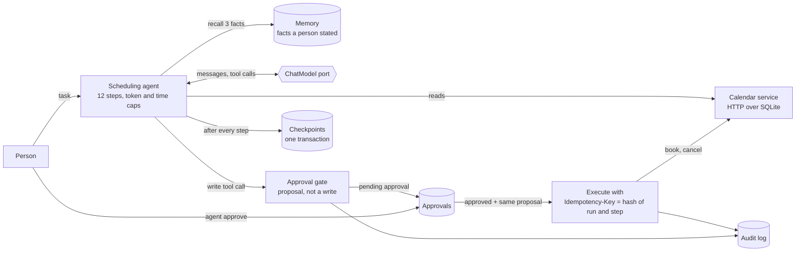

# Mermaid diagrams

## What it is

**Mermaid** is a way to draw diagrams by writing text. You put the description inside a code fence marked `mermaid`; a viewer that supports it (GitHub does) turns the text into a picture. A **flowchart** is a diagram of boxes (**nodes**) joined by arrows (**edges**), usually showing how data or control moves through a system.

## Why this repository uses it

`ARCHITECTURE.md` explains how the system is organized, and a picture of the parts and the arrows between them is the fastest way to see that. Because the picture is text, it lives in version control: a change to the design is a visible change in a diff, and nobody has to maintain a separate image file.

## Where it appears

| File | What it does with this technology |
| --- | --- |
| `ARCHITECTURE.md` | the diagram |

## How it works underneath

The viewer loads the Mermaid library, which parses the text into a graph (nodes and edges), computes a layout, and draws it as SVG. Node ids (`PG`, `CH`) are only names used to connect arrows; the visible text is the label in brackets. The shape of the brackets chooses the shape of the node: `[text]` a box, `[(text)]` a database cylinder, `{text}` a diamond (a decision), `{{text}}` a hexagon. `<br/>` inside a label starts a new line. An arrow can carry a label between pipes: `A -->|label| B`.

## Walkthrough of this repository's use

The diagram in `ARCHITECTURE.md`:



Line by line:

- `flowchart LR`: the diagram type is a **flowchart**; `LR` means it is laid out left to right.
- `P[Person] -->|task| A[Scheduling agent<br/>12 steps, token and time caps]`: draws an arrow, with the label "task" from `P` (a box labeled "Person") to `A` (a box labeled "Scheduling agent / 12 steps, token and time caps").
- `A -->|recall 3 facts| MEM[(Memory<br/>facts a person stated)]`: draws an arrow, with the label "recall 3 facts" from `A` (defined earlier: a box labeled "Scheduling agent / 12 steps, token and time caps") to `MEM` (a database cylinder labeled "Memory / facts a person stated").
- `A <-->|messages, tool calls| M{{ChatModel port}}`: draws an arrow with a head at both ends, with the label "messages, tool calls" from `A` (defined earlier: a box labeled "Scheduling agent / 12 steps, token and time caps") to `M` (a hexagon labeled "ChatModel port").
- `A -->|reads| CAL[Calendar service<br/>HTTP over SQLite]`: draws an arrow, with the label "reads" from `A` (defined earlier: a box labeled "Scheduling agent / 12 steps, token and time caps") to `CAL` (a box labeled "Calendar service / HTTP over SQLite").
- `A -->|write tool call| G[Approval gate<br/>proposal, not a write]`: draws an arrow, with the label "write tool call" from `A` (defined earlier: a box labeled "Scheduling agent / 12 steps, token and time caps") to `G` (a box labeled "Approval gate / proposal, not a write").
- `G -->|pending approval| AP[(Approvals)]`: draws an arrow, with the label "pending approval" from `G` (defined earlier: a box labeled "Approval gate / proposal, not a write") to `AP` (a database cylinder labeled "Approvals").
- `P -->|agent approve| AP`: draws an arrow, with the label "agent approve" from `P` (defined earlier: a box labeled "Person") to `AP` (defined earlier: a database cylinder labeled "Approvals").
- `AP -->|approved + same proposal| X[Execute with<br/>Idempotency-Key = hash of run and step]`: draws an arrow, with the label "approved + same proposal" from `AP` (defined earlier: a database cylinder labeled "Approvals") to `X` (a box labeled "Execute with / Idempotency-Key = hash of run and step").
- `X -->|book, cancel| CAL`: draws an arrow, with the label "book, cancel" from `X` (defined earlier: a box labeled "Execute with / Idempotency-Key = hash of run and step") to `CAL` (defined earlier: a box labeled "Calendar service / HTTP over SQLite").
- `A -->|after every step| CK[(Checkpoints<br/>one transaction)]`: draws an arrow, with the label "after every step" from `A` (defined earlier: a box labeled "Scheduling agent / 12 steps, token and time caps") to `CK` (a database cylinder labeled "Checkpoints / one transaction").
- `X --> AU[(Audit log)]`: draws an arrow from `X` (defined earlier: a box labeled "Execute with / Idempotency-Key = hash of run and step") to `AU` (a database cylinder labeled "Audit log").
- `G --> AU`: draws an arrow from `G` (defined earlier: a box labeled "Approval gate / proposal, not a write") to `AU` (defined earlier: a database cylinder labeled "Audit log").

## Try it yourself

1. Find the fence that starts the diagram.

```bash
grep -n 'mermaid' ARCHITECTURE.md
```

What you should see (captured from this repository):

```text
34:```mermaid
```

2. How many lines of Mermaid text the diagram has.

```bash
awk '/```mermaid/{f=1;next} /```/{f=0} f' ARCHITECTURE.md | wc -l | tr -d ' '
```

What you should see (captured from this repository):

```text
13
```

3. How many arrows (solid, with or without a label) it draws.

```bash
awk '/```mermaid/{f=1;next} /```/{f=0} f' ARCHITECTURE.md | grep -c -- '-->'
```

What you should see (captured from this repository):

```text
12
```

## Mistakes people make

- **Reusing a node id for two things.** The second definition would replace the first. Ids are unique.
- **A label with brackets or quotes.** They can end the node early; labels here avoid them.
- **Expecting every viewer to draw it.** Some editors show the text. The surrounding paragraphs say the same thing in words.
- **Forgetting `end` after `subgraph`.** The group would swallow the rest of the diagram.

## Check yourself

1. What does `A -->|yes| B` draw?

   *Answer:* An arrow from A to B labeled "yes".

2. Which brackets draw a database cylinder?

   *Answer:* `[( ... )]`.

3. What does `flowchart LR` set?

   *Answer:* A flowchart laid out left to right.

4. What is a node id for?

   *Answer:* To connect edges; the visible text is the label.

5. What does `-.->` draw?

   *Answer:* A dotted arrow.

## Further reading

- Mermaid documentation, https://mermaid.js.org/syntax/flowchart.html (the diagrams could not be rendered in this session; the explanation was generated from the diagram text by a parser that stops on any syntax it does not know).
